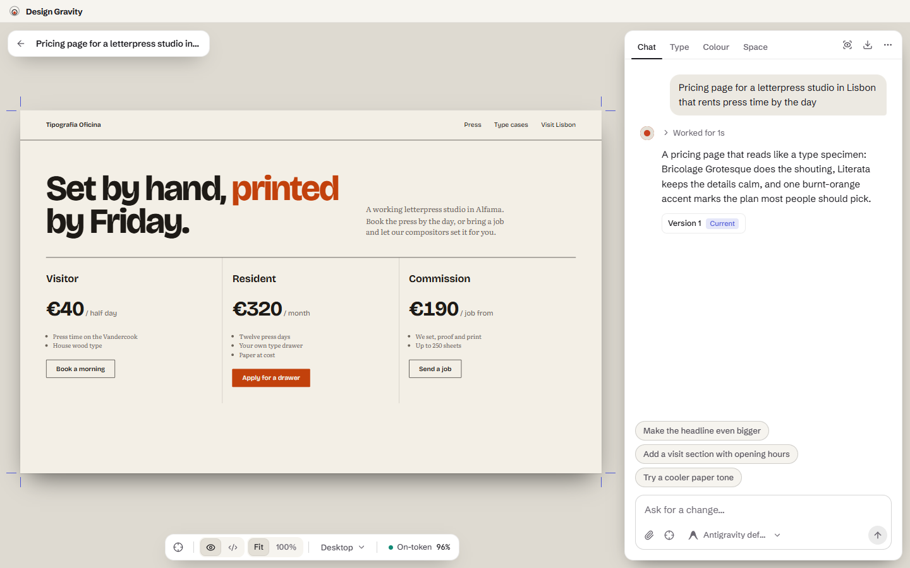
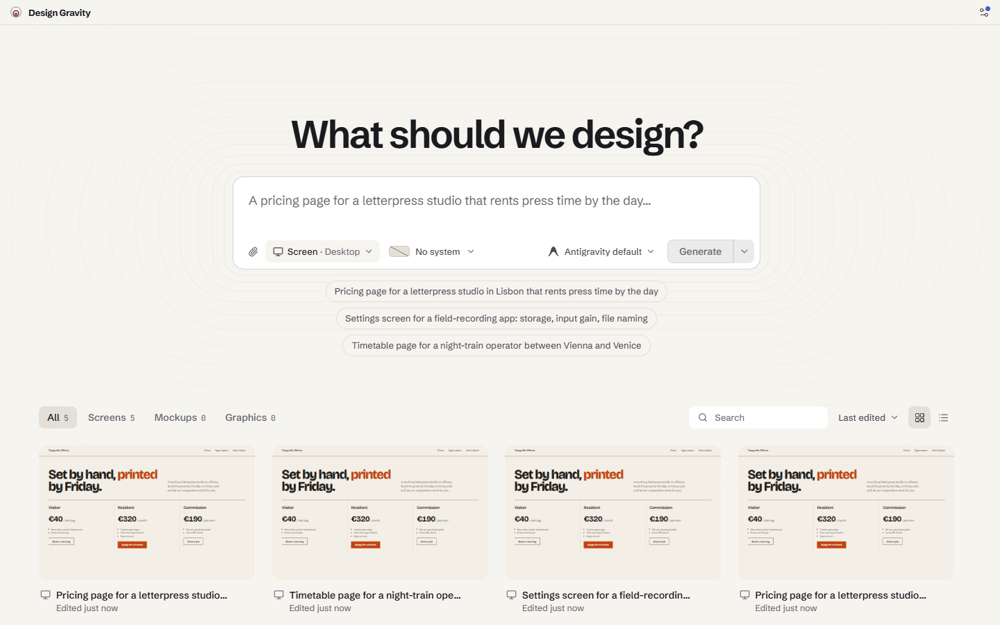
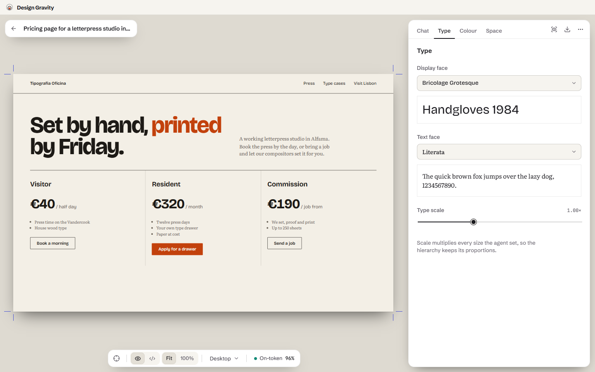
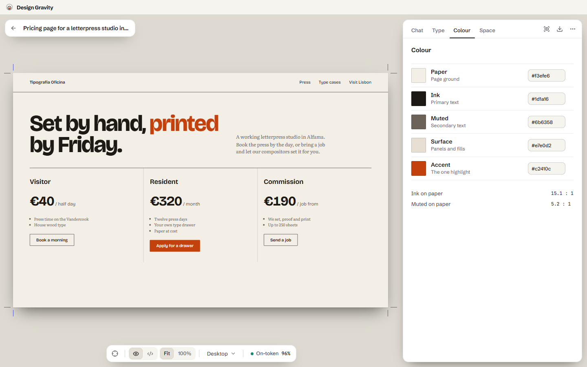
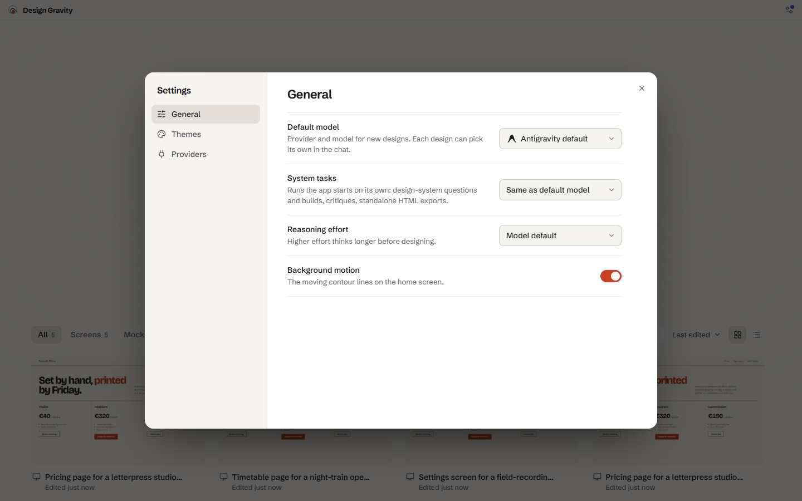

<div align="center">


# Design Gravity

**Write a brief. Get an editable design.**

A local-first desktop app that turns a written brief into HTML/React screens or SVG graphics, generated by your own agent CLI, then lets you keep shaping the result by hand.


</div>

<p align="center">
  
</p>

---

## Overview

Design Gravity has no hosted backend and asks for no API keys. Generation is done by **your own agent CLI**, [Antigravity](https://antigravity.google) (`agy`) or [OpenAI Codex](https://github.com/openai/codex) (`codex`), run headless inside a per-design workspace folder. The agent writes real files on disk, conversations are resumable, and your own models and quota are used.

You describe what you want, watch the agent work, and get a finished design you can keep editing, either by prompt or directly through typography, colour, radius and spacing controls.

## Features

| | |
|---|---|
| **Brief to design** | Screens (HTML/CSS or React projects), graphics (SVG) and mockups from a single prompt. |
| **Two providers** | Switch between Antigravity and Codex per design. Model lists come straight from each CLI. |
| **Token editor** | Every design exposes `--dg-*` CSS custom properties. Change fonts, scale, colours, radius and spacing live, without re-prompting. |
| **Point and revise** | Pick an element on the canvas and leave a margin note; the agent revises just that part. |
| **Critique** | Ask for a structured review. Findings are anchored to elements on the page. |
| **Version history** | Each revision is snapshotted. Restore or fork any version. |
| **Variants** | Generate alternatives side by side and keep the best one. |
| **Design systems** | Build a reusable system from a short interview, then apply it to new designs. |
| **Honest agent log** | A live "galley" shows what the agent is doing and fails loudly and recoverably. |
| **Export** | HTML, SVG or PNG, plus a standalone single-file HTML export. |
| **Local-first** | Your machine, your CLI, your files. Fonts are self-hosted, so the app works offline. |

## Screenshots

<table>
  <tr>
    <td width="50%"><br /><sub><b>The Wall.</b> Brief composer and every design you have made.</sub></td>
    <td width="50%"><br /><sub><b>Type.</b> Swap display and text faces and scale the whole hierarchy.</sub></td>
  </tr>
  <tr>
    <td width="50%"><br /><sub><b>Colour.</b> Edit paper, ink and accent tokens directly.</sub></td>
    <td width="50%"><br /><sub><b>Settings.</b> Default model, reasoning effort, themes and providers.</sub></td>
  </tr>
</table>

## How it works

```
 brief ──► agent CLI (agy / codex, headless) ──► files in the design workspace
                      │                                      │
                      └── streamed JSON events ──► galley    ▼
                                                    sandboxed preview
                                                           │
                                       token editor · notes · critique · export
```

1. The app runs the chosen CLI headless in `designs/<id>/` under the app data directory and streams each JSON event back to the UI.
2. The design is a single `design.html` / `design.svg`, or a small React project rendered in a Web Worker (sucrase plus `renderToStaticMarkup`), so agent-written code never touches the app window.
3. Previews load in a sandboxed iframe. Your token overrides are layered on top of the agent's `:root` values.
4. Follow-up prompts resume the same agent conversation. A conversation belongs to its provider; switching provider on an existing design starts a fresh thread in the same workspace.

## Getting started

### Prerequisites

- [Node.js](https://nodejs.org) 20 or newer
- [Rust](https://www.rust-lang.org/tools/install) (stable) and the [Tauri v2 prerequisites](https://v2.tauri.app/start/prerequisites/) for Windows (WebView2, MSVC build tools)
- At least one signed-in agent CLI:
  - Antigravity (`agy`), or
  - OpenAI Codex (`codex`)

### Install and run

```bash
git clone https://github.com/Koki4a08/design-gravity.git
cd design-gravity
npm install
npm run app
```

### Scripts

| Command | What it does |
|---|---|
| `npm run app` | Full desktop app (Rust and web view) via `tauri dev` |
| `npm run dev` | Vite only on port 1420, against a mock backend, for UI work in the browser |
| `npm run build` | Type check (`tsc -b`) and production web build |
| `npm run app:build` | Release bundle of the desktop app |
| `cargo check --manifest-path src-tauri/Cargo.toml` | Rust-only check |

The browser preview accepts a few URL parameters for the mock backend: `?auth=out` (signed-out state) and `?updates=off` (no CLI updates pending).

## Project structure

```
src/
  components/
    shell/      titlebar, settings, toasts, CLI updates
    hub/        the Wall: gallery and brief composer
    editor/     the Spread: canvas, chat, critique, versions, export
    systems/    design-system builder
    ui/         shared primitives
  lib/
    backend/    the single seam to native code (Tauri invoke or mock)
    design/     prompts, tokens, audit, themes
    project/    React project renderer (Web Worker)
    state/      app state providers
  styles/       plain CSS with custom-property tokens
src-tauri/
  src/          agy.rs, codex.rs, designs.rs, updates.rs, window.rs
```

## Tech stack

- **Shell:** Tauri v2 (Rust)
- **UI:** React 19, TypeScript (strict), Vite
- **Styling:** plain CSS with custom-property tokens
- **Type:** Schibsted Grotesk, Source Serif 4, JetBrains Mono (self-hosted via Fontsource)
- **Rendering:** sucrase and `react-dom/server` inside a Web Worker for React designs

## Product notes

Product intent, principles and the CLI flags used for headless runs are documented in [`PRODUCT.md`](PRODUCT.md).

Principles in short: the design is the page; every generation stays editable; agent state is shown honestly; everything stays local.
